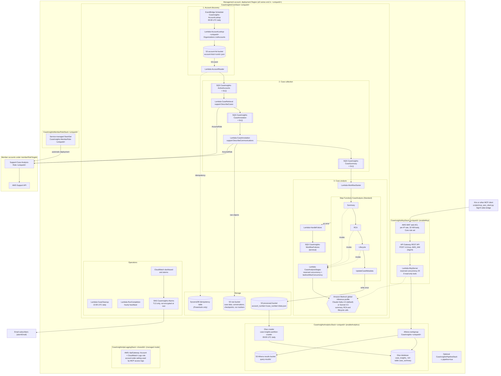
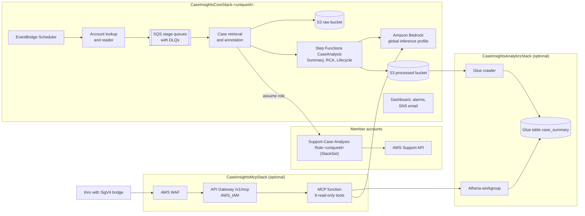

# Support Case Insights

Support Case Insights collects the resolved AWS Support cases of every member account in one AWS Organization, summarises and classifies each case with Amazon Bedrock, and makes the results available through Amazon Athena, CSV export and an optional Model Context Protocol (MCP) server for assistants such as Kiro. It is an AWS CDK v2 (TypeScript) application with Python 3.12 Lambda functions, deployed from the management account of the organisation.

> **Status.** Version 0.1.0. Everything in this repository is verified locally (lint, type checks, unit, integration and CDK assertion tests, synthesis with cdk-nag), but nothing has been deployed to AWS yet. The checks that need a real deployment are listed in [Deferred live verification](#deferred-live-verification).

## Table of contents

1. [Overview](#overview)
   - [Architecture](#architecture)
   - [AWS services](#aws-services)
   - [Cost](#cost)
2. [Prerequisites](#prerequisites)
3. [Deployment](#deployment)
4. [Deployment validation](#deployment-validation)
5. [Running the solution](#running-the-solution)
6. [Updating and reprocessing](#updating-and-reprocessing)
7. [Cleanup](#cleanup)
8. [Security](#security)
9. [FAQ, known limitations and additional considerations](#faq-known-limitations-and-additional-considerations)
10. [Local verification](#local-verification)
    - [Continuous integration](#continuous-integration)
11. [Deferred live verification](#deferred-live-verification)
12. [Documentation](#documentation)
13. [Revisions](#revisions)
14. [Notices](#notices)
15. [Licence](#licence)

## Overview

Support cases record what went wrong in your AWS estate and how it was fixed, but they are spread across every account in the organisation and are hard to analyse together. Support Case Insights:

- discovers every active member account each day and reads its resolved cases and their complete conversations through a read-only role, `Support-Case-Analysis-Role-<uniqueId>`, which a service-managed StackSet deploys to every account under the configured root or organisational units;
- makes three focused Amazon Bedrock calls per case: a 600 to 650 character summary, a root cause analysis (RCA) category from a fixed taxonomy of 16, and an operational lifecycle category from a fixed taxonomy of 20, each with a short reason (see [prompts](docs/prompts.md));
- stores one processed JSON record per case in Amazon S3 and never analyses a committed case again unless you ask it to;
- optionally catalogues the records in AWS Glue for Athena queries and Amazon QuickSight, exports them to CSV for Power BI or Excel, and serves eight read-only MCP tools over an IAM-authenticated API.

The default model is the global cross-Region inference profile for Claude Haiku 4.5 (`global.anthropic.claude-haiku-4-5-20251001-v1:0`); the only alternative is Claude Sonnet 4.5 (`global.anthropic.claude-sonnet-4-5-20250929-v1:0`).

### Architecture



The full diagram and its source are in [architecture](docs/architecture.md) and [docs/images/architecture.mmd](docs/images/architecture.mmd). In outline:



How a case flows through the solution:

1. At 00:00 UTC (configurable) an EventBridge Scheduler schedule invokes `Lambda-AccountLookup-<uniqueId>`, which lists the organisation's active member accounts, excluding the management account, and writes the list to S3.
2. The S3 event invokes the account reader, which sends one message per account to the active-accounts queue.
3. `Lambda-CaseRetrieval-<uniqueId>` assumes `Support-Case-Analysis-Role-<uniqueId>` in the member account, lists resolved cases created within `lookbackMonths` that have no processed record, stores their metadata in the raw bucket and queues them. Accounts without a qualifying Support plan or without the role are skipped and counted.
4. `Lambda-CaseAnnotation-<uniqueId>` reads each case's complete conversation, stores it and queues the case for analysis.
5. The workflow starter starts one execution of the Standard state machine `CaseAnalysis-<uniqueId>` per case. Its Summary, RCA and Lifecycle steps each call Bedrock once, with concurrency capped at `bedrockMaxConcurrency`, and validate the output; the UpdateCaseMetadata step commits the processed record. Failures are retried, then recorded on a failure queue.
6. Daily cleanup resets abandoned work so that the next run retries it, and an hourly check emits the `DailyRunCompleted` heartbeat once every account and case of a run is settled.
7. With Analytics, the 09:00 UTC crawler adds new partitions so that Athena, QuickSight and the MCP tools can query the records. The CSV exporter reads the processed bucket directly.
8. With MCP, Kiro or another client sends SigV4-signed JSON-RPC requests through the local bridge `scripts/mcp_aws_client.py` to `POST /v1/mcp`, protected by AWS WAF, IAM authorisation and a resource policy, and the MCP function answers from Athena and Bedrock.

Why it is built this way, in brief: SQS queues buffer per-account and per-case work, isolate retries and collect failures in dead-letter queues; Step Functions sequences the three Bedrock calls with explicit retries and failure handling; three separate prompts keep each task focused and let each output be validated on its own; a service-managed StackSet deploys the member role automatically to every current and future account in the targets; and DynamoDB is used only for Powertools idempotency. See [architecture](docs/architecture.md#design-rationale).

### AWS services

| Service | Use |
| --- | --- |
| AWS Organizations, AWS CloudFormation StackSets | Account discovery; deployment of the member role to every member account |
| AWS Support API | Read-only `DescribeCases` and `DescribeCommunications` in member accounts |
| Amazon EventBridge Scheduler, AWS Lambda, Amazon SQS, AWS Step Functions | Scheduling, processing, buffering and workflow |
| Amazon Bedrock | Summary and classification (global cross-Region inference) and MCP analysis tools |
| Amazon S3, Amazon DynamoDB | Raw and processed data, account lists, access logs; Powertools idempotency records |
| AWS Glue, Amazon Athena | Optional catalogue, partition crawler and SQL queries |
| Amazon API Gateway, AWS WAF | Optional MCP endpoint |
| Amazon CloudWatch, AWS X-Ray, Amazon SNS | Logs, metrics, dashboard, alarms, tracing and alarm email |
| AWS CodePipeline, AWS CodeBuild, AWS CodeConnections | Optional deployment pipeline |

### Cost

You are responsible for the cost of the AWS services used while running this solution. An illustrative scenario (us-east-1, 50 member accounts, 300 newly resolved cases a month, Claude Haiku 4.5, Analytics enabled, light MCP use) comes to roughly **$15 to $25 per month**: about $15 without MCP and about $25 with it. It is an estimate at approximate list prices at the time of writing, not a guarantee.

| Item | Approximate monthly cost in the scenario |
| --- | --- |
| AWS WAF web ACL and rules (MCP only, fixed) | $8 |
| CloudWatch alarms, custom metrics and dashboard | $8 |
| Amazon Bedrock (three calls per case, plus MCP analysis tools) | $4.50 |
| AWS Glue crawler (daily) | $3 |
| SQS, S3, Lambda, Step Functions, DynamoDB, Athena, API Gateway and others | $2 |

The first run backfills up to 12 months of resolved cases, a one-off Bedrock cost of roughly $35 with Haiku or $110 with Sonnet for 3,600 cases. Bedrock cost grows linearly with case volume and conversation length. The optional pipeline adds CodePipeline and CodeBuild charges per release, roughly $0.20 to $0.50 each, so a handful of releases a month costs a few dollars; more releases cost proportionally more. [Cost](docs/cost.md) explains every driver, the controls (`bedrockMaxConcurrency`, `lookbackMonths`, model choice, retention, the Athena per-query scan cutoff, disabling MCP) and how to create an AWS Budgets alert. Prices vary by Region; use the [AWS Pricing Calculator](https://calculator.aws/).

## Prerequisites

- **Node.js** 20 LTS from 20.19, 22 from 22.13, or 24 and later (`package.json` engines `^20.19.0 || ^22.13.0 || >=24`; `.nvmrc` pins 24.22.3). The AWS CDK v2 CLI is pinned in `package.json`; run it with `npx cdk`.
- **Python 3.12** for the Lambda assets, tests and scripts.
- **AWS CLI v2**, authenticated with credentials for the **management account** of the organisation.
- **Deployment permissions** as described in [permissions](docs/permissions.md).
- **A qualifying AWS Support plan** (Business, Enterprise On-Ramp or Enterprise) on each member account whose cases you want; other accounts are skipped.
- **StackSets trusted access** with AWS Organizations:

  ```bash
  aws organizations enable-aws-service-access --service-principal member.org.stacksets.cloudformation.amazonaws.com
  ```

- **Amazon Bedrock model access** to the configured Anthropic model in your Region. Anthropic's first-time use (FTU) use-case details, submitted in the Bedrock console or with `aws bedrock put-use-case-for-model-access`, and an AWS Marketplace subscription with a valid payment method may be required; IAM cannot complete them for you. See [installation](docs/installation.md#step-4-prepare-the-account-once).
- **Network access** to the npm registry and the Python package index for the first install and synthesis.

Docker and Finch are not used or needed: Python assets are bundled locally from hash-locked wheels. No AWS credentials are needed for local verification. [Installation](docs/installation.md#prerequisites) has the full list.

## Deployment

Run these commands from the repository root. Commands that call AWS were not run during development; see [Deferred live verification](#deferred-live-verification).

```bash
# 1. Clone and install
git clone https://github.com/bsadkins/factorytestsample.git && cd factorytestsample
npm ci
python3 -m venv .venv && source .venv/bin/activate && pip install -r requirements-dev.txt

# 2. Configure
cp config/example.json config/prod.json
aws organizations describe-organization --query 'Organization.Id' --output text
aws sts get-caller-identity --query Account --output text
# Edit config/prod.json: uniqueId, orgId, managementAccountId, region, memberRoleTargets,
# enableAnalytics, enableMcp, alarmEmail, bedrockModelId

# 3. Verify locally
npm run verify

# 4. Bootstrap once
npx cdk bootstrap aws://<managementAccountId>/<region> -c env=prod

# 5. Review and deploy
npx cdk diff --all -c env=prod
npx cdk deploy --all -c env=prod --require-approval broadening

# 6. Confirm SNS email subscription
```

Notes on each step (details in [installation](docs/installation.md)):

1. `python3` must be Python 3.12. Replace `bsadkins` with your GitHub owner if you use a fork.
2. Every field, its default and allowed values are in [configuration](docs/configuration.md). `cp` replaces the shipped `config/prod.json`, which holds invented values. `config/dev.json` is the dev counterpart (Analytics and MCP enabled); give each environment its own `uniqueId`.
3. `npm run verify` validates the configuration and runs cdk-nag; any error stops here, before AWS is involved.
4. Bootstrap once per account and Region, after enabling StackSets trusted access (above) and Bedrock model access. The `-c env=prod` context is required: run from the repository root, `cdk bootstrap` synthesises the app in `cdk.json` even when given an explicit `aws://` target, and the app stops without an environment. Any valid environment file works (`-c env=dev` bootstraps the same account and Region). With MCP enabled, first check who owns the account's API Gateway logging role: `aws apigateway get-account --region <region> --query cloudwatchRoleArn --output text` (see [Shared API Gateway logging prerequisite](docs/mcp-server-deployment.md#shared-api-gateway-logging-prerequisite)).
5. Always use `--all`; the app has several stacks. With MCP in the default managed logging mode the app also deploys `CaseInsightsApiLoggingStack-<sharedId>`, which sets the account- and Region-wide API Gateway CloudWatch role: review that change in the diff, because it affects every REST API in the Region. The StackSet deploys `Support-Case-Analysis-Role-<uniqueId>` to every member account under `memberRoleTargets`, including accounts that join later; no per-member deployment is needed.
6. AWS emails a confirmation link to `alarmEmail` (required in prod); no alarm is delivered until it is confirmed.

For dev, use the same steps with `config/dev.json` and `-c env=dev`. The optional approval-gated pipeline is described in [pipeline](docs/pipeline.md): before its first run, copy `config/pipeline.example.json` to `config/pipeline.json`, fill it in and **commit `config/pipeline.json`, `config/dev.json` and `config/prod.json` to `main`**, because the pipeline synthesises from the repository.

## Deployment validation

Replace `<region>` and `<uniqueId>` with the values from `config/<env>.json`. Every regional command names the Region, so the result does not depend on your AWS CLI profile's default Region. Processing is asynchronous: the account lookup returns once it has written the account list, and cases are analysed afterwards, so run the steps in order in one shell and wait where indicated. Expected results, the zero-case path and failures are explained in [installation](docs/installation.md#step-7-validate-the-deployment).

Copy each step separately, in order, in the same shell. The stop conditions are executable: do not paste a later step after an earlier one stops.

**1. Check the stacks and member role instances.**

```bash
aws cloudformation list-stacks --region <region> --stack-status-filter CREATE_COMPLETE UPDATE_COMPLETE \
  --query "StackSummaries[?starts_with(StackName,'CaseInsights')].StackName"
aws cloudformation list-stack-instances --region <region> --stack-set-name CaseInsights-MemberRole-<uniqueId> \
  --call-as SELF --query 'Summaries[].[Account,Status]' --output table
```

Expect every `CaseInsights*` stack of the environment and every stack instance `CURRENT`.

**2. Start a run and note its `runId`.**

```bash
aws lambda invoke --region <region> --function-name Lambda-AccountLookup-<uniqueId> account-lookup.json
cat account-lookup.json
```

The response contains the `runId` used below. The dashboard `CaseInsights-<uniqueId>` shows the run's progress.

**3. Wait for processing and require at least one processed case.**

```bash
RAW_BUCKET=$(aws cloudformation describe-stacks --region <region> --stack-name CaseInsightsCoreStack-<uniqueId> \
  --query "Stacks[0].Outputs[?OutputKey=='RawBucketName'].OutputValue" --output text) || {
  printf 'STOP: could not find the raw bucket.\n' >&2; exit 1;
}
COMPLETION=$(aws s3 cp --region <region> "s3://$RAW_BUCKET/runs/<runId>/completion.json" -) || {
  printf 'STOP: the completion marker is not available; retry this step after the next hourly check.\n' >&2
  exit 1
}
printf '%s\n' "$COMPLETION"
CASES_PROCESSED=$(printf '%s\n' "$COMPLETION" | python3 -c \
  'import json, sys; print(json.load(sys.stdin)["counts"]["casesProcessed"])') || {
  printf 'STOP: the completion marker has no readable casesProcessed count.\n' >&2; exit 1;
}
case "$CASES_PROCESSED" in
  ''|*[!0-9]*) printf 'STOP: casesProcessed is not a non-negative integer.\n' >&2; exit 1 ;;
esac
if [ "$CASES_PROCESSED" -eq 0 ]; then
  printf 'STOP: no cases were processed; skip Glue and Athena and start a later run from step 2.\n'
  exit 0
fi
```

The copy fails with `404` until Run Completion (hourly) has seen every account and case reach a final outcome. A zero count is an expected result when there are no resolved cases in the lookback window or every account was skipped; the commands stop before Glue and Athena in that case.

**4. Crawl the new partitions and require a successful crawl** (only when `enableAnalytics` is `true`).

```bash
aws glue start-crawler --region <region> --name case-insights-partition-crawler-<uniqueId> || {
  printf 'STOP: could not start the crawler; do not query Athena yet.\n' >&2; exit 1;
}
sleep 60
while :; do
  CRAWLER_STATE=$(aws glue get-crawler --region <region> \
    --name case-insights-partition-crawler-<uniqueId> \
    --query 'Crawler.State' --output text) || {
    printf 'STOP: could not read crawler state.\n' >&2; exit 1;
  }
  [ "$CRAWLER_STATE" = READY ] && break
  sleep 30
done
CRAWL_STATUS=$(aws glue get-crawler --region <region> \
  --name case-insights-partition-crawler-<uniqueId> \
  --query 'Crawler.LastCrawl.Status' --output text) || {
  printf 'STOP: could not read the crawl result.\n' >&2; exit 1;
}
aws glue get-crawler --region <region> --name case-insights-partition-crawler-<uniqueId> \
  --query 'Crawler.LastCrawl.[Status,StartTime,ErrorMessage]' --output text
if [ "$CRAWL_STATUS" != SUCCEEDED ]; then
  printf 'STOP: the crawl did not succeed; do not query Athena yet.\n' >&2
  exit 1
fi
```

Continue only after `SUCCEEDED`, with a `StartTime` later than the `start-crawler` call. For `FAILED` or `CANCELLED`, use the printed `ErrorMessage` and [Athena troubleshooting](docs/athena.md#troubleshooting).

**5. Query Athena and require a successful query before reading results.**

```bash
DATABASE=$(aws cloudformation describe-stacks --region <region> --stack-name CaseInsightsAnalyticsStack-<uniqueId> \
  --query "Stacks[0].Outputs[?OutputKey=='GlueDatabaseName'].OutputValue" --output text) || {
  printf 'STOP: could not find the Analytics database.\n' >&2; exit 1;
}
QUERY_ID=$(aws athena start-query-execution --region <region> --work-group CaseInsights-<uniqueId> \
  --query-execution-context Database="$DATABASE" \
  --query-string 'SELECT rca_category, count(*) AS cases FROM case_summary GROUP BY 1 ORDER BY 2 DESC' \
  --query QueryExecutionId --output text) || {
  printf 'STOP: could not start the Athena query.\n' >&2; exit 1;
}
STATE=QUEUED
while [ "$STATE" = QUEUED ] || [ "$STATE" = RUNNING ]; do
  sleep 5
  STATE=$(aws athena get-query-execution --region <region> --query-execution-id "$QUERY_ID" \
    --query 'QueryExecution.Status.State' --output text) || {
    printf 'STOP: could not read the Athena query state.\n' >&2; exit 1;
  }
done
aws athena get-query-execution --region <region> --query-execution-id "$QUERY_ID" \
  --query 'QueryExecution.Status.[State,StateChangeReason]' --output text
if [ "$STATE" != SUCCEEDED ]; then
  printf 'STOP: the Athena query did not succeed; results are unavailable.\n' >&2
  exit 1
fi
aws athena get-query-results --region <region> --query-execution-id "$QUERY_ID" --output table
```

A successful query returns one row per RCA category. For `FAILED` or `CANCELLED`, use the printed reason and [Athena troubleshooting](docs/athena.md#troubleshooting). Every dead-letter queue should stay empty.

### Connect Kiro

With MCP enabled:

1. Add the IAM role or user ARN you use locally to `mcpAllowedPrincipals` and deploy.
2. Get the endpoint: `aws cloudformation describe-stacks --region <region> --stack-name CaseInsightsMcpStack-<uniqueId> --query 'Stacks[0].Outputs'` (output `McpEndpointUrl`).
3. `cp .kiro/settings/mcp.json.example .kiro/settings/mcp.json`, then set `MCP_SERVER_URL` and `AWS_REGION` in it.
4. Open the repository in Kiro and confirm that eight tools are listed.

Claude Desktop, awscurl and troubleshooting are covered in [MCP server deployment](docs/mcp-server-deployment.md).

## Running the solution

The daily run starts at 00:00 UTC, cleanup runs at 22:00 UTC and the crawler at 09:00 UTC (all configurable). Start a run at any time with `aws lambda invoke --function-name Lambda-AccountLookup-<uniqueId> --region <region> account-lookup.json`; committed cases are skipped. [Usage](docs/usage.md) explains how to follow a run, where results are stored and how long they are kept.

- **Athena and QuickSight.** Query the table `case_summary` in the workgroup `CaseInsights-<uniqueId>`. [Athena](docs/athena.md) documents the schema, partitions and crawler, and a query library for RCA distribution, lifecycle categories by service, temporal patterns, severity trends and top accounts, plus an optional manual QuickSight set-up.
- **CSV.** `.venv/bin/python scripts/generate_csv_insights.py` exports processed records for Power BI or Excel without Athena; see [CSV export](docs/csv_export.md).
- **MCP tools.** Ask questions such as "Which services drive most of our cases?", "What is the top root cause this quarter?", "Do incidents cluster on Mondays?" or "Summarise last month's cases".

| Tool | What it does |
| --- | --- |
| `query_athena` | Runs one read-only SQL statement against `case_summary`, with paging and resumable `PENDING` results |
| `analyze_with_bedrock` | Asks the configured Bedrock model a question about supplied data |
| `get_case_summary` | RCA category distribution, with filters |
| `analyze_case_summaries` | Bedrock analysis of the case summaries in a date range |
| `get_temporal_patterns` | Day-of-week, week-of-month and monthly trend counts, computed inline in one query |
| `get_rca_analysis` | RCA counts grouped by service, severity, account, month or lifecycle category |
| `get_lifecycle_analysis` | Lifecycle counts grouped by service, severity, account, month or RCA category |
| `get_service_trends` | Case counts by service, period and RCA category |

Alarms and their responses are in the [runbook](docs/runbook.md); metrics and the dashboard in [monitoring](docs/monitoring.md); log fields and queries in [logging](docs/logging.md); common problems in [troubleshooting](docs/troubleshooting.md).

## Updating and reprocessing

```bash
npm run verify && npx cdk deploy --all -c env=prod
```

Run `npx cdk diff --all -c env=prod` first to review the change. Add accounts by adding their root or OU to `memberRoleTargets`; accounts that join an existing target receive the role automatically. The runbook has step-by-step procedures to [collect from a new OU](docs/runbook.md#collect-from-a-new-organisational-unit-or-account), [change a quota](docs/runbook.md#change-a-bedrock-or-lambda-quota), [change the model](docs/runbook.md#change-the-bedrock-model) and [recover from a failed deployment](docs/runbook.md#recover-from-a-failed-deployment-or-update).

Committed cases are not analysed again after a prompt, taxonomy or model change. Reprocess a date range explicitly; the script previews the plan and acts only after you confirm its token:

```bash
.venv/bin/python scripts/reprocess-cases.py --env prod --from <YYYY-MM-DD> --to <YYYY-MM-DD>
```

To retry messages in a stage dead-letter queue after fixing the cause, use `scripts/redrive-dlq.sh --env <env> --queue <active-accounts|annotation|summary>`. Both tools are described in [Recovery tools](docs/runbook.md#recovery-tools).

## Cleanup

```bash
npx cdk destroy --all -c env=prod
```

- **Prod retains its data.** The Core buckets (account-list, raw, processed, access-log), the Athena results bucket, the idempotency table and the log groups remain after `destroy`, because they hold case data. Empty and delete them deliberately when you no longer need them. Dev deletes them. No customer managed KMS key exists, so there is no key to retain or delete.
- **StackSet instances.** Deleting the MemberRole stack deletes the StackSet after CloudFormation removes its instances and every `Support-Case-Analysis-Role-<uniqueId>`. Confirm with `aws cloudformation describe-stack-set --region <region> --stack-set-name CaseInsights-MemberRole-<uniqueId>` (expect `StackSetNotFoundException`); if instances remain, delete them with `aws cloudformation delete-stack-instances` and destroy again.
- **Shared API Gateway logging.** The logging role and account setting outlive every environment. Remove them by hand only after every MCP environment in the account and Region is gone, as described in [Teardown and final clean-up](docs/mcp-server-deployment.md#teardown-and-final-clean-up).
- **Pipeline and trusted access.** Destroy the pipeline stack and its retained buckets if you used it, and deactivate StackSets trusted access only if nothing else needs it.

The copy-paste teardown, including emptying versioned buckets, is in [resources](docs/resources.md#teardown).

## Security

- **Least privilege.** The member role can only call `support:DescribeCases` and `support:DescribeCommunications` and trusts only the two collector roles of this deployment in the same organisation. Every function has its own role, Bedrock access is limited to the configured inference profile, and every other model is denied. See [permissions](docs/permissions.md).
- **Encryption.** S3 (SSE-S3), SQS (SSE-SQS), DynamoDB (AWS owned key), CloudWatch Logs (default service-side encryption) and Athena results (`SSE_S3`) use AWS managed or AWS owned encryption; no customer managed KMS key is used. Buckets, queues and the alarm topic deny requests without TLS.
- **Alarm topic exception.** By explicit user approval, the alarm topic `CaseInsights-Alarms-<uniqueId>` is **not encrypted at rest**. CloudWatch alarms can publish to an encrypted SNS topic only when it uses a customer managed KMS key; the AWS managed key `alias/aws/sns` does not let CloudWatch publish. The topic enforces TLS and only CloudWatch alarms of this deployment may publish. Notifications contain no case content, but they do contain operational metadata (alarm names and descriptions, states, metric values, the account ID, the Region and resource names), which leaves the account through the confirmed email subscriptions. The cdk-nag finding `AwsSolutions-SNS2` is acknowledged for this topic only, with that justification.
- **Data handling.** Case content goes only to Amazon Bedrock and to storage in your account. Logs, metrics and traces carry no case content. Global cross-Region inference profiles may process requests in any AWS commercial Region; the data stays within AWS and is not sent to external services or telemetry.
- **MCP endpoint.** SigV4 (`AWS_IAM`) authorisation, a resource policy limited to `mcpAllowedPrincipals` in your organisation, AWS WAF (rate limit, 32 KiB body limit, managed core rules), fixed reserved concurrency of 20 and a SQL guard that accepts one read-only statement against `case_summary` only.
- **cdk-nag** runs on every synthesis; each of the 81 acknowledgements has a written reason, listed in [security](docs/security.md#cdk-nag).

[Security](docs/security.md) contains the threat model, data classification, shared responsibility model and environment inventory. Report vulnerabilities privately, as described in [CONTRIBUTING](CONTRIBUTING.md#security-issues).

## FAQ, known limitations and additional considerations

- **Which cases are collected?** Resolved cases only, created within the last `lookbackMonths` months (at most 12, the AWS Support API's retention), from member accounts with a qualifying Support plan. The management account's own cases are not collected.
- **Can one deployment cover several organisations?** No. One deployment serves one organisation, from its management account and one Region.
- **When do new results appear in Athena?** After the next crawler run (09:00 UTC by default) or a manual `aws glue start-crawler`. The CSV exporter does not wait for the crawler.
- **Model availability.** Only the two global Anthropic inference profiles are accepted. They must be available and enabled in your Region; the Anthropic FTU form and AWS Marketplace subscription may be needed, and IAM cannot complete them.
- **Retries are not exactly-once.** After an uncertain outcome, such as a timeout after a request was sent, a stage can rarely invoke Bedrock again for the same case. Stage checkpoints and the processed-record check keep this rare, and a committed processed record stops any further automatic inference; explicit reprocessing is the only exception.
- **Large conversations.** A conversation too large for the summary prompt is stored in full but not truncated or summarised; it is recorded as a `ConversationTooLarge` failure.
- **MCP time budget.** Each MCP tool call has a 25-second budget inside API Gateway's 29-second limit. botocore's `read_timeout` bounds each socket read rather than the whole response, so the budget relies on the non-streaming Athena and Bedrock `InvokeModel` responses arriving at once (see `src/lambda/mcp_tools/limits.py`). Long Athena queries return `PENDING`; call `query_athena` again with the `queryExecutionId`. Results are truncated at `maxRows`, page, time or 256 KiB limits and say so.
- **SQL guard.** `query_athena` accepts one `SELECT` or `WITH ... SELECT` statement (or `SHOW` and `DESCRIBE` of the configured table) that reads only `case_summary`, and rejects comments, stacked statements, data-changing and session keywords, recursive CTEs and qualified function calls. The workgroup also cancels queries that scan more than `operations.athena.bytesScannedCutoffPerQuery`. Full rules: [Read-only SQL rules](docs/mcp-server-deployment.md#read-only-sql-rules).
- **Local tests are not Athena.** The MCP tools are tested against an SQLite stand-in; SQLite is not Trino, so the Athena SQL dialect and paging are proven only by the deferred live checks.
- **Alarm email.** Dev ships without `alarmEmail`, so its alarms change state without notifying anyone; prod requires an address. Alarms have no OK actions.
- **Shared API Gateway logging.** In managed mode the solution owns the account- and Region-wide API Gateway CloudWatch role setting; use existing mode if another team owns it.
- **Small objects and Standard-IA.** Processed records are usually smaller than 128 KB, so S3 does not transition them to Standard-IA; they stay in S3 Standard.

More answers are in [troubleshooting](docs/troubleshooting.md).

## Local verification

These steps work from a fresh clone without AWS credentials, Docker or global packages (Node.js and Python 3.12 only), and never call AWS:

```bash
npm ci
python3.12 -m venv .venv
.venv/bin/python -m pip install --require-hashes -r requirements-dev.txt
npm run verify                                     # lint, type checks, tests, dev and prod synth with cdk-nag
npx cdk synth -c env=dev --no-lookups --quiet      # one environment, into cdk.out/
.venv/bin/pytest test/scripts/test_mcp_aws_client.py   # SigV4 bridge against the loopback MCP fixture
.venv/bin/python scripts/mcp_aws_client.py --help
.venv/bin/python scripts/generate_csv_insights.py --help
.venv/bin/python scripts/reprocess-cases.py --help
scripts/redrive-dlq.sh --help
```

The first `npm ci`, `pip install` and synthesis need access to the npm registry and the Python package index. Synthesis bundles the Lambda layer from the hash-locked wheels in `requirements.txt` and caches them in `.cache/pip`; later synths reuse the cache. A missing wheel or a hash mismatch fails synthesis; nothing is compiled on the host and there is no Docker fallback. Assets are content-addressed: synthesising again without changes produces the same templates, and editing a file in `src/templates/` changes only the templates layer asset (its S3 key in the Core template). An ordinary `cdk deploy` uploads the new asset, publishes a new layer version and updates the functions that use it; no manual upload is needed.

| Command | What it runs |
| --- | --- |
| `npm run lint` | ESLint and Ruff lint and format checks |
| `npm run typecheck` | Strict `tsc --noEmit` and mypy |
| `npm test` | Jest (configuration, CDK assertions and snapshots) and pytest with coverage (80% minimum for `src/lambda`) |
| `npm run synth` | `cdk synth` for `dev` and `prod` with cdk-nag; any unacknowledged finding fails |
| `npm run verify` | All of the above |
| `npm run security` | npm advisory scan of the full lockfile, `pip-audit` of both Python locks, and Bandit |

The tests use invented data and local stand-ins for AWS (moto, botocore stubbers, an SQLite stand-in for Athena and a loopback SigV4 endpoint) and never call AWS. They cover every Lambda handler, the Core pipeline end to end, the recovery scripts, the MCP tools through the real stdio bridge, and the security-critical properties of every synthesised stack. They prove local behaviour and template properties only, not IAM, WAF, Athena or Bedrock behaviour in a live account. See [development](docs/development.md).

### Continuous integration

Every pull request runs [`.github/workflows/ci.yml`](.github/workflows/ci.yml) on `ubuntu-24.04` with Node.js 24.22.3 (from `.nvmrc`) and Python 3.12.3. It runs `npm ci`, installs `requirements-dev.txt` into `.venv` with `--require-hashes`, runs `npm run verify` and fails if verification changed the working tree. The workflow has read-only repository permissions, uses no AWS credentials or repository secrets, pins every action to a commit SHA and caches `.cache/pip` keyed on the two Python lock files.

## Deferred live verification

None of the following has been run. Local tests, snapshots, synthesis and cdk-nag are not evidence for them; each needs a real AWS deployment, starting with dev:

- [ ] Clean deployment of the dev configuration with `npx cdk deploy --all -c env=dev`, after bootstrapping and enabling StackSets trusted access.
- [ ] With no changes, a second `npx cdk diff --all -c env=dev` reports no differences and a second `npx cdk deploy --all -c env=dev` completes without changing any stack.
- [ ] The member role StackSet instances reach `CURRENT`, and `Support-Case-Analysis-Role-<uniqueId>` exists in the targeted member accounts with the expected trust.
- [ ] Member accounts with Business, Enterprise On-Ramp or Enterprise Support return cases; accounts without it are skipped as `SubscriptionRequired`.
- [ ] A manual run processes real cases through Bedrock (model access, FTU and Marketplace subscription in place), writes processed records with valid categories, and leaves every dead-letter and terminal queue empty with no alarms.
- [ ] The Anthropic FTU submission works through the console or `aws bedrock put-use-case-for-model-access`, and the runbook's [operational procedures](docs/runbook.md#operational-procedures) (new OU, quota change, model change, failed deployment recovery) work as written.
- [ ] `scripts/redrive-dlq.sh` starts a real SQS move task, and `scripts/reprocess-cases.py` reprocesses a test case with only the documented permissions.
- [ ] The dashboard shows data, the alarm email subscription is confirmed, a test notification arrives, and `DailyRunCompleted` is emitted after a run.
- [ ] The crawler adds partitions, and the Athena [query library](docs/athena.md#query-library) returns results in the workgroup with SSE-S3 encrypted results.
- [ ] `aws apigateway get-account --region <region> --query cloudwatchRoleArn --output text` shows the shared logging role (managed mode) or the existing role, the MCP stage deploys and its access log group receives records; destroying dev leaves the role and setting in place.
- [ ] Kiro connects through the bridge and lists the eight tools, and **each of the eight MCP tools is run once against the real dev Athena workgroup** and returns correct results, including temporal aggregates. The local SQLite fixture adapters are not proof of Trino or Athena execution.
- [ ] `query_athena` rejects a non-`SELECT` statement; unsigned requests, unlisted principals and principals outside the organisation receive `403`; WAF returns `413` for bodies over 32 KiB and `429` above the per-IP rate.
- [ ] The optional manual QuickSight set-up works with the enforced workgroup, and a CSV export from the real processed bucket succeeds with only the documented S3 permissions.
- [ ] The optional pipeline's connection is available, its Build step passes, and prod deploys only after approval (see [pipeline](docs/pipeline.md#deferred-live-verification)).

## Documentation

| Document | Contents |
| --- | --- |
| [Architecture](docs/architecture.md) | Diagram, data flow, stacks and components, design rationale and data schema |
| [Installation](docs/installation.md) | Prerequisites, every configuration field, one-time set-up, deployment, validation, Kiro, QuickSight, pipeline, update and removal |
| [Configuration](docs/configuration.md) | Type, default, allowed values and effect of every field; validation errors; dev and prod examples; environment variables |
| [Permissions](docs/permissions.md) | Deployer, every runtime role and its justification, member role trust, analyst, CSV and MCP permissions |
| [Security](docs/security.md) | Shared responsibility, data classification, encryption and the SNS exception, threat model, Bedrock inference, retry limitations, cdk-nag acknowledgements |
| [Resources](docs/resources.md) | Every stack and resource, names, dependencies, retention and teardown |
| [Usage](docs/usage.md) | Schedules, manual runs, dashboard, Athena, QuickSight, CSV and Kiro |
| [Athena](docs/athena.md) | Table schema, partitions, crawler, query library and QuickSight |
| [CSV export](docs/csv_export.md) | Permissions, options, scheduling, Power BI and Excel |
| [MCP server deployment](docs/mcp-server-deployment.md) | The eight tools, SQL rules and limits, shared API logging, SigV4 bridge, Kiro, Claude Desktop, awscurl and troubleshooting |
| [Prompts](docs/prompts.md) | Templates, full taxonomies and definitions, validation, versioning, customisation and reprocessing |
| [Monitoring](docs/monitoring.md) | Every metric, alarm and threshold, dashboard, X-Ray, SNS and production guidance |
| [Logging](docs/logging.md) | Log groups, retention, safe structured fields, messages by stage and Logs Insights queries |
| [Runbook](docs/runbook.md) | Diagnosis and repair for every alarm, redrive and reprocessing |
| [Troubleshooting](docs/troubleshooting.md) | Installation, StackSet, AccessDenied, SubscriptionRequired, missing data, Athena, Bedrock, MCP and performance problems |
| [Development](docs/development.md) | Set-up, layout, tests, linting, cdk-nag, adding a Lambda function or MCP tool |
| [Cost](docs/cost.md) | Cost per service, scaling, illustrative scenario, controls and AWS Budgets |
| [Pipeline](docs/pipeline.md) | Optional approval-gated CDK pipeline |
| [Contributing](CONTRIBUTING.md), [Code of Conduct](CODE_OF_CONDUCT.md), [Changelog](CHANGELOG.md), [Licence](LICENSE) | Project policies and history |

### Repository layout

```
.github/workflows/   Pull request CI (ci.yml)
bin/case-insights.ts CDK app entry point
lib/config/          Typed configuration, validation and resource names
lib/constructs/      CDK constructs (storage, queues, roles, functions, analysis, observability, analytics, MCP)
lib/packaging/       Docker-free Python asset bundling and content hashing
lib/stacks/          CDK stacks, including the shared API logging and optional pipeline stacks
lib/stages/          CDK Pipelines stages
config/              Schemas and environment configuration
src/lambda/<name>/   One directory per Lambda handler
src/lambda/common/   Shared Python package (Lambda layer)
src/templates/       Prompt templates (templates layer)
scripts/             CSV exporter, MCP SigV4 bridge, recovery tools and taxonomy renderer
docs/                Documentation and the architecture diagram
test/cdk/            CDK assertions, cdk-nag and per-stack snapshots (Jest)
test/                Other Jest and pytest suites, fixtures and test helpers
```

## Revisions

Changes are recorded in the [changelog](CHANGELOG.md). The current version is 0.1.0.

## Notices

Customers are responsible for making their own independent assessment of the information in this repository. This repository: (a) is for informational purposes only, (b) represents current practices, which are subject to change without notice, and (c) does not create any commitments or assurances from AWS and its affiliates, suppliers or licensors. AWS products or services are provided "as is" without warranties, representations or conditions of any kind, whether express or implied. The responsibilities and liabilities of AWS to its customers are controlled by AWS agreements, and this repository is not part of, nor does it modify, any agreement between AWS and its customers.

Amazon Bedrock model output is generated text. Review summaries and classifications before relying on them for decisions.

## Licence

This project is licensed under the MIT No Attribution licence (MIT-0); see [LICENSE](LICENSE). Copyright (c) 2026 bsadkins. Contributions are welcome under the same licence; see [CONTRIBUTING](CONTRIBUTING.md) and the [Code of Conduct](CODE_OF_CONDUCT.md).
