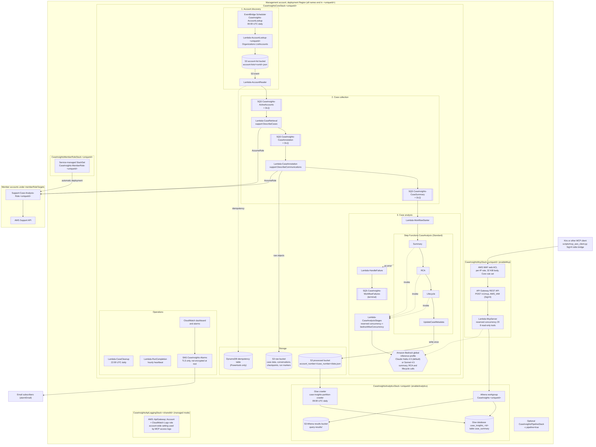
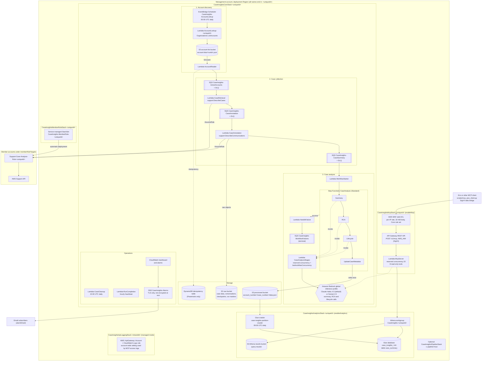

# Architecture

This document describes how Support Case Insights is built: the stacks and the components in each, the path a support case takes from the daily schedule to Athena and the MCP server, the reasons behind the main design choices, and the shape of the data at each stage. It is derived from the CDK code in `lib/`, the Lambda code in `src/lambda/` and the synthesised templates in `cdk.out/dev` and `cdk.out/prod`. Nothing has been deployed to AWS, so the runtime behaviour described here is verified by local tests only. Physical names, retention and teardown are listed in [resources](resources.md), IAM roles and policies in [permissions](permissions.md), data protection in [security](security.md), and metrics, alarms and the dashboard in [monitoring](monitoring.md).

## Diagram

Every stack and resource runs in the management account and the configured `region`, except `Support-Case-Analysis-Role-<uniqueId>`, which the member role StackSet deploys to the member accounts. Names in the diagram omit the `-<uniqueId>` suffix where space is short; the full names are in [resources](resources.md).

The diagram source is [images/architecture.mmd](images/architecture.mmd). The same source, rendered by Mermaid:

## End-to-end data flow

1. **Schedule.** At `schedules.accountLookup` (default `cron(0 0 * * ? *)`, 00:00 UTC), the EventBridge Scheduler schedule `CaseInsights-AccountLookup-<uniqueId>` invokes `Lambda-AccountLookup-<uniqueId>` asynchronously. The run ID is derived from the scheduled time (`YYYYMMDDTHHMMSSZ`), so a repeated delivery does not start a second run.
2. **Account lookup.** The function pages through AWS Organizations `ListAccounts`, keeps `ACTIVE` accounts other than the management account and writes the list to `account-lists/<runId>.json` in the account-list bucket with a conditional create (`IfNoneMatch: *`).
3. **Fan-out to SQS.** The S3 event notification for `account-lists/*.json` invokes `Lambda-AccountReader-<uniqueId>`, which validates the list and sends one `{accountId, accountName, runId}` message per account to `CaseInsights-ActiveAccounts-<uniqueId>`. Powertools idempotency, keyed on the bucket, key and version, stops a duplicate S3 event from enqueuing a run twice. Failed asynchronous invocations of both discovery functions, and failed schedule deliveries, go to `CaseInsights-AccountDiscoveryFailures-<uniqueId>`.
4. **Case retrieval.** `Lambda-CaseRetrieval-<uniqueId>` consumes the active-accounts queue (batch size 1, maximum concurrency 5). For each account it assumes `Support-Case-Analysis-Role-<uniqueId>` in that member account, pages through `DescribeCases` for cases created in the last `lookbackMonths` calendar months, keeps resolved cases that have no processed record, writes each case's metadata to the raw bucket and sends one reference per case to `CaseInsights-CaseAnnotation-<uniqueId>`. Accounts where the role is missing or untrusted, access is denied, or the support plan does not include the Support API (`SubscriptionRequiredException`) are counted as skipped for that run.
5. **Case annotation.** `Lambda-CaseAnnotation-<uniqueId>` (batch size 5, maximum concurrency 5) assumes the same member role, pages through `DescribeCommunications`, stores the complete conversation in the raw bucket and sends a summary reference to `CaseInsights-CaseSummary-<uniqueId>`. A conversation too large for the summary prompt is stored but reported to `CaseInsights-WorkflowFailures-<uniqueId>` instead of being truncated.
6. **Workflow start.** `Lambda-WorkflowStarter-<uniqueId>` (batch size 10, maximum concurrency `operations.workflow.starterMaxConcurrency`, default 2) starts one execution of the Standard state machine `CaseAnalysis-<uniqueId>` per case attempt. A conditional write of the ownership marker `workflow.json` in the raw bucket makes sure only one execution owns a case at a time, and a case that already has a processed record is never started.
7. **Summary.** The `Summary` task invokes `Lambda-CaseAnalysisStages-<uniqueId>`, which renders the conversation into the summary prompt and calls Amazon Bedrock through the configured global inference profile. The reply must be a 600 to 650 character, four to six sentence plain-prose summary; one corrective follow-up is allowed, after which the stage fails.
8. **RCA.** The `RCA` task calls Bedrock with the validated summary and the 16 root cause categories, and validates the returned category and reason.
9. **Lifecycle.** The `Lifecycle` task does the same with the 20 operational lifecycle categories. Each stage writes a validated checkpoint to the raw bucket, so a retried execution reuses completed stages instead of calling Bedrock again.
10. **Commit.** The `UpdateCaseMetadata` task (`Lambda-UpdateCaseMetadata-<uniqueId>`) combines the metadata and the three stage outputs into one 18-field processed record and writes it once, with a conditional create, to `account_number=<accountId>/case_number=<displayId>/data.json` in the processed bucket. Any task error that its retries do not resolve goes to `HandleFailure` (`Lambda-HandleFailure-<uniqueId>`), which sends a content-free failure record to `CaseInsights-WorkflowFailures-<uniqueId>` and fails the execution.
11. **Reconciliation and completion.** `Lambda-CaseCleanup-<uniqueId>` (daily, `schedules.cleanup`, default 22:00 UTC) resets abandoned, unfinished cases so the next run collects them again. `Lambda-RunCompletion-<uniqueId>` (hourly) checks the run markers in the raw bucket and emits the `DailyRunCompleted` heartbeat once every account and case of a run has reached a terminal outcome.
12. **Monitoring.** Every function, the state machine and the queues feed the dashboard `CaseInsights-<uniqueId>` and the alarms `CaseInsights-<uniqueId>-*`, which notify the SNS topic `CaseInsights-Alarms-<uniqueId>` and its confirmed email subscription (`alarmEmail`).
13. **Cataloguing.** With Analytics enabled, the Glue crawler `case-insights-partition-crawler-<uniqueId>` runs on `schedules.crawler` (default 09:00 UTC) and adds the `account_number` and `case_number` partitions of new records to the table `case_summary` in `case_insights_<uniqueId>`. New records become queryable after the next crawl.
14. **Athena.** Analysts, QuickSight and the MCP server query the table through the Athena workgroup `CaseInsights-<uniqueId>`, which enforces SSE-S3 results under `query-results/` in its results bucket and a per-query scan cutoff. The [CSV exporter](csv_export.md) reads the processed bucket directly instead.
15. **MCP.** With MCP enabled, an MCP client such as Kiro runs the local stdio bridge `scripts/mcp_aws_client.py`, which signs each JSON-RPC request with SigV4 and sends it to `POST /v1/mcp`. AWS WAF checks the request rate and body size, API Gateway authorises the caller with `AWS_IAM` and its resource policy, and `Lambda-McpServer-<uniqueId>` runs one of eight read-only tools against Athena or the configured Bedrock model.

## Stacks

All stacks deploy to `managementAccountId` in `region`. `npx cdk deploy --all -c env=<env>`, run from the repository root, deploys them in dependency order.

| Stack | Created when | Scope | Depends on |
| --- | --- | --- | --- |
| `CaseInsightsCoreStack-<uniqueId>` | Always | Management account, `region` | Nothing |
| `CaseInsightsMemberRoleStack-<uniqueId>` | Always | Management account; its StackSet deploys to member accounts under `memberRoleTargets`, `region` only | Core (the member role trusts two Core roles, which must exist first) |
| `CaseInsightsAnalyticsStack-<uniqueId>` | `enableAnalytics` is `true` | Management account, `region` | Core |
| `CaseInsightsMcpStack-<uniqueId>` | `enableMcp` is `true` (requires `enableAnalytics`) | Management account, `region` | Core, Analytics and, in managed mode, the shared logging stack |
| `CaseInsightsApiLoggingStack-<sharedId>` | `enableMcp` is `true` and `apiGatewayLogging.mode` is `managed` (the default) | One per account and Region, shared by every environment there | Nothing |
| `CaseInsightsPipelineStack` | Only with `-c pipeline=true`, instead of `-c env=<env>` | Management account, pipeline `region` | Deploys the stacks above through CDK Pipelines |

Core never depends on an optional stack. Cross-stack values use weak references (`Fn::GetStackOutput`), so no CloudFormation exports tie the stacks together. The shipped dev configuration produces Core, MemberRole, Analytics, MCP and `CaseInsightsApiLoggingStack-scishared`; the shipped prod configuration produces Core, MemberRole and Analytics.

### Components per stack

| Stack | Components |
| --- | --- |
| Core | Account-list, raw, processed and access-log S3 buckets; the DynamoDB idempotency table; three stage queues (`ActiveAccounts`, `CaseAnnotation`, `CaseSummary`), each with a dead-letter queue, and two terminal queues (`WorkflowFailures`, `AccountDiscoveryFailures`); ten Python 3.12 functions (`AccountLookup`, `AccountReader`, `CaseRetrieval`, `CaseAnnotation`, `WorkflowStarter`, `CaseAnalysisStages`, `UpdateCaseMetadata`, `HandleFailure`, `CaseCleanup`, `RunCompletion`) and two layers (`case-insights-common-<uniqueId>`, `case-insights-templates-<uniqueId>`); the Standard state machine `CaseAnalysis-<uniqueId>`; three Scheduler schedules (account lookup, cleanup, run completion); the alarm topic, 23 alarms (27 with MCP) and the dashboard. The two collector roles `CaseInsights-CaseRetrieval-<uniqueId>` and `CaseInsights-CaseAnnotation-<uniqueId>` are the only principals the member role trusts |
| MemberRole | The service-managed StackSet `CaseInsights-MemberRole-<uniqueId>`, with automatic deployment, that creates `Support-Case-Analysis-Role-<uniqueId>` (only `support:DescribeCases` and `support:DescribeCommunications`) in each member account |
| Analytics | Glue database `case_insights_<uniqueId>` (hyphens become underscores), external table `case_summary`, partition crawler `case-insights-partition-crawler-<uniqueId>` and its role, Athena workgroup `CaseInsights-<uniqueId>` (engine version 3, enforced configuration) and the results bucket |
| MCP | Regional REST API `CaseInsights-Mcp-<uniqueId>` with stage `v1` and `POST /mcp` (`AWS_IAM`), resource policy limited to `mcpAllowedPrincipals` in the Organization, AWS WAF web ACL `CaseInsights-Mcp-<uniqueId>` (per-IP rate rule, 32 KiB body limit, AWS managed Core rule set), `Lambda-McpServer-<uniqueId>` (reserved concurrency fixed at 20, 28-second timeout), its log group and the access log group `/aws/apigateway/CaseInsights-Mcp-<uniqueId>/access`. The four MCP alarms and dashboard rows are added to Core |
| ApiLogging | One IAM role trusted by `apigateway.amazonaws.com` and one `AWS::ApiGateway::Account` resource that sets it as the account and Region CloudWatch role, both retained; see [Shared API Gateway logging prerequisite](mcp-server-deployment.md#shared-api-gateway-logging-prerequisite) |
| Pipeline | CodePipeline V2 pipeline with source, build, self-mutation, the shared logging stage, dev, the manual approval `PromoteToProd` and prod; see [pipeline](pipeline.md) |

## Design rationale

### SQS between account lookup and per-account processing

Account discovery produces one message per account, and case collection produces one message per case, instead of one function looping over the whole organisation.

- **Buffering.** A large organisation or a 12-month first backfill produces a burst of work that the queues absorb; consumers drain it at their own pace within the 4-day queue retention.
- **Concurrency control.** Event source mapping maximum concurrency (5 for retrieval and annotation, `starterMaxConcurrency` for the starter) bounds how many member accounts are called at once, which keeps the Support API and STS within their quotas, independent of the number of accounts.
- **Retry isolation.** Each account and each case is its own message. The mappings report partial batch failures, so one failing account or case is retried without repeating the others, and one slow account cannot hold up the run.
- **Dead-letter queues.** After `operations.queues.maxReceiveCount` receives (default 3), a message moves to the stage's `-DLQ` queue, where an alarm fires and [Redrive a stage dead-letter queue](runbook.md#redrive-a-stage-dead-letter-queue) can send it back once the cause is fixed.

### Step Functions for the analysis

Each case runs as one Standard execution of `CaseAnalysis-<uniqueId>`: `Summary`, `RCA`, `Lifecycle`, then `UpdateCaseMetadata`, with `HandleFailure` on every task's Catch. The state machine provides per-task retry policies (Lambda throttling up to 8 attempts with full jitter, Bedrock throttling and transient errors, S3 and timeout errors up to `operations.workflow.taskMaxAttempts`), an execution timeout (`operations.workflow.executionTimeoutMinutes`, default 60) and a visible execution history for each case. Standard workflows suit work that can wait on throttled Bedrock retries for many minutes, and their stable execution names (`<account>-<case>-<runId>-a<attempt>`) let the starter detect a running owner instead of starting a duplicate. State holds only references to S3 objects, and execution data is excluded from the logs, so case content never passes through the Step Functions log group.

### Three separate Bedrock calls

The summary, RCA classification and lifecycle classification are three prompts rather than one.

- **Focused prompts.** Each template asks for one output with its own rules: a plain-prose summary of fixed length, or a JSON object with one category and a reason. The classifiers read only the validated summary, not the whole conversation, so their prompts stay short.
- **Independent validation.** Each reply is checked on its own. A summary that fails the length, sentence, formatting or preamble rules gets one corrective follow-up and then fails the stage; nothing is padded or cut.
- **Taxonomy-checked categories.** A category must be exactly one of the labels in `src/lambda/common/taxonomy.py` (16 RCA, 20 lifecycle). An invalid or missing category, or a reason over 500 characters, gets one corrective follow-up; if that also fails, the stage records `Unclassified` with an explanatory reason and the workflow continues. `Unclassified` therefore means the reply could not be accepted, not that the case was judged unclassifiable.
- **Independent checkpoints and retries.** Each stage writes a checkpoint, so a failure in Lifecycle does not repeat the summary call. A stage retried after an uncertain outcome (for example a timeout after the request was sent) may rarely repeat one inference; exactly-once inference is not promised. A committed processed record stops further automatic inference for the case, and only explicit, opt-in reprocessing with `scripts/reprocess-cases.py` analyses it again.

All three stages run in `Lambda-CaseAnalysisStages-<uniqueId>`, whose reserved concurrency equals `bedrockMaxConcurrency`, and each invocation makes its Bedrock calls one at a time. Concurrent Bedrock requests from the pipeline therefore never exceed that value. Prompt details are in [prompts](prompts.md).

### Service-managed StackSet for the member role

The member role is deployed by the service-managed StackSet `CaseInsights-MemberRole-<uniqueId>` with automatic deployment to the roots or OUs in `memberRoleTargets`. Every current account under those targets receives `Support-Case-Analysis-Role-<uniqueId>`, and accounts that join a target later receive it automatically; accounts that leave lose it (`RetainStacksOnAccountRemoval` is `false`). Nothing has to be deployed manually in any member account. Service-managed StackSets never deploy to the management account, and account lookup excludes it, so management account cases are not collected. StackSets trusted access with AWS Organizations must be activated once before deployment.

### DynamoDB only for Powertools idempotency

The single DynamoDB table is AWS Lambda Powertools idempotency storage for Account Reader, Case Retrieval, Case Annotation and Workflow Starter. It absorbs duplicate S3 events and SQS deliveries, holds no case content and expires records after 7 days. It does not coordinate work: SQS carries the work, Step Functions runs each case, and conditional S3 writes (account list, ownership marker, processed record, run markers) settle races.

### Global inference profiles

`bedrockModelId` accepts only `global.anthropic.claude-haiku-4-5-20251001-v1:0` (default) or `global.anthropic.claude-sonnet-4-5-20250929-v1:0`. Global cross-Region inference profiles give higher throughput than a single Region. Requests may be routed to any AWS commercial Region worldwide; the data stays within AWS, application data is stored only in the customer's account, and no case content is sent to external services or telemetry. The Bedrock policy allows only the configured profile and its foundation models through that profile, and denies every other model. Anthropic models may need the first-time use form and an AWS Marketplace subscription, which IAM permissions cannot complete.

### No Docker

Python Lambda assets are bundled locally during `cdk synth` from hash-locked CPython 3.12 manylinux x86_64 wheels (`pip --require-hashes --only-binary=:all:`). Nothing is compiled on the host, so Docker and Finch are not used or needed. The first synth needs access to the package index; wheels are then cached in `.cache/pip`.

### AWS-managed encryption and the SNS exception

Every bucket uses SSE-S3, queues use SSE-SQS, the DynamoDB table uses its default AWS owned key, CloudWatch Logs uses its default service-side encryption and Athena results use `SSE_S3`. No customer managed KMS keys exist, and no KMS permissions are needed. The one exception is the alarm topic `CaseInsights-Alarms-<uniqueId>`, which is not encrypted at rest: CloudWatch alarms can publish to an encrypted topic only when it uses a customer managed KMS key, and the AWS managed key for SNS does not allow it. The topic policy denies `sns:Publish` without TLS and allows `cloudwatch.amazonaws.com` to publish only for this account's alarms named `CaseInsights-<uniqueId>-*`; principals in the account whose own IAM policies allow `sns:Publish` can also publish over TLS. Notifications contain no case content, but they do contain operational metadata (alarm names and descriptions, states, metric values, the account ID, the Region and resource names), which leaves the account through the confirmed email subscriptions. See [security](security.md).

## Data schema

### S3 key layout

All keys in the raw and processed buckets use Hive-style partitions so the Glue table can map them directly. `<displayId>` is the case number shown in the Support Center.

| Bucket | Key | Written by | Content |
| --- | --- | --- | --- |
| Account-list | `account-lists/<runId>.json` | Account Lookup | `{schemaVersion, runId, generatedAt, accounts: [{accountId, accountName}], counts}` |
| Raw | `account_number=<accountId>/case_number=<displayId>/data.json` | Case Retrieval | Case metadata from `DescribeCases` |
| Raw | `account_number=<accountId>/case_number=<displayId>/communications.json` | Case Annotation | Complete conversation from `DescribeCommunications` |
| Raw | `account_number=<accountId>/case_number=<displayId>/workflow.json` | Workflow Starter, Case Cleanup | Ownership marker naming the execution that owns the case |
| Raw | `account_number=<accountId>/case_number=<displayId>/checkpoints/{summary,rca,lifecycle}.json` | Case Analysis Stages | Validated stage output, reused only for the same case, model, prompt version and input digest |
| Raw | `account_number=<accountId>/case_number=<displayId>/terminal-failure.json` | Case Annotation | Digest of a conversation too large to summarise |
| Raw | `account_number=<accountId>/case_number=<displayId>/failure-deliveries/<executionName>.json` | Starter, Handle Failure, Cleanup, Run Completion | Pending or sent failure-record delivery |
| Raw | `runs/<runId>/accounts/<accountId>.json`, `runs/<runId>/cases/<accountId>/<displayId>.json`, `runs/<runId>/completion.json` | Retrieval, Annotation, Starter, Run Completion | Run markers (identifiers and counts only) |
| Raw | `cleanup-state/cursor.json` | Case Cleanup | Resume position |
| Processed | `account_number=<accountId>/case_number=<displayId>/data.json` | Update Case Metadata | The processed record, written once |

Raw and account-list objects expire after `rawRetentionDays`; processed records never expire. Retention per bucket is in [resources](resources.md).

### Processed record

One JSON object with exactly these 18 fields (`common.processed_record.PROCESSED_FIELDS`). A record with any other field set fails validation and is not written.

| Field | JSON type | Notes |
| --- | --- | --- |
| `caseId` | string | Support case ID |
| `displayId` | string | Case number, equal to the `case_number` partition |
| `subject` | string or null | As returned by `DescribeCases` |
| `serviceCode` | string or null | As returned |
| `categoryCode` | string or null | As returned |
| `severityCode` | string or null | As returned |
| `submittedBy` | string or null | As returned (personal data) |
| `timeCreated` | string | Case creation time as returned by Support |
| `Case_Retrieval_Date` | string | `YYYY-MM-DDTHH:MM:SSZ` |
| `Case_Summary` | string | 600 to 650 characters, four to six sentences |
| `RCA_Category` | string | One of 16 RCA labels or `Unclassified` |
| `RCA_Reason` | string | At most 500 characters |
| `RCA_Retrieval_Date` | string | `YYYY-MM-DDTHH:MM:SSZ` |
| `Lifecycle_Category` | string | One of 20 lifecycle labels or `Unclassified` |
| `Lifecycle_Reason` | string | At most 500 characters |
| `Lifecycle_Retrieval_Date` | string | `YYYY-MM-DDTHH:MM:SSZ` |
| `Model_Id` | string | The global inference profile used |
| `Prompt_Version` | string | `pv-` and a 16-character digest of the templates and taxonomies |

### Glue table

The external table `case_summary` in `case_insights_<uniqueId>` reads `s3://<processed bucket>/` with the OpenX JSON SerDe (case-sensitive mapping from lower-case column names to the mixed-case JSON keys). It has 18 `string` columns (`caseid`, `displayid`, `subject`, `servicecode`, `categorycode`, `severitycode`, `submittedby`, `timecreated`, `case_retrieval_date`, `case_summary`, `rca_category`, `rca_reason`, `rca_retrieval_date`, `lifecycle_category`, `lifecycle_reason`, `lifecycle_retrieval_date`, `model_id`, `prompt_version`) and two `string` partition keys, `account_number` and `case_number`. The crawler only adds partitions and logs schema changes. Column meanings, nullability and example queries are in [Table schema](athena.md#table-schema).

## Related documents

- [resources](resources.md): every resource, name, output, retention setting and the teardown procedure.
- [security](security.md): data protection, encryption and trust boundaries.
- [permissions](permissions.md): every IAM role, trust policy and resource policy.
- [monitoring](monitoring.md): metrics, alarms, dashboard, heartbeat and tracing.
- [cost](cost.md): cost drivers and an illustrative monthly estimate.
